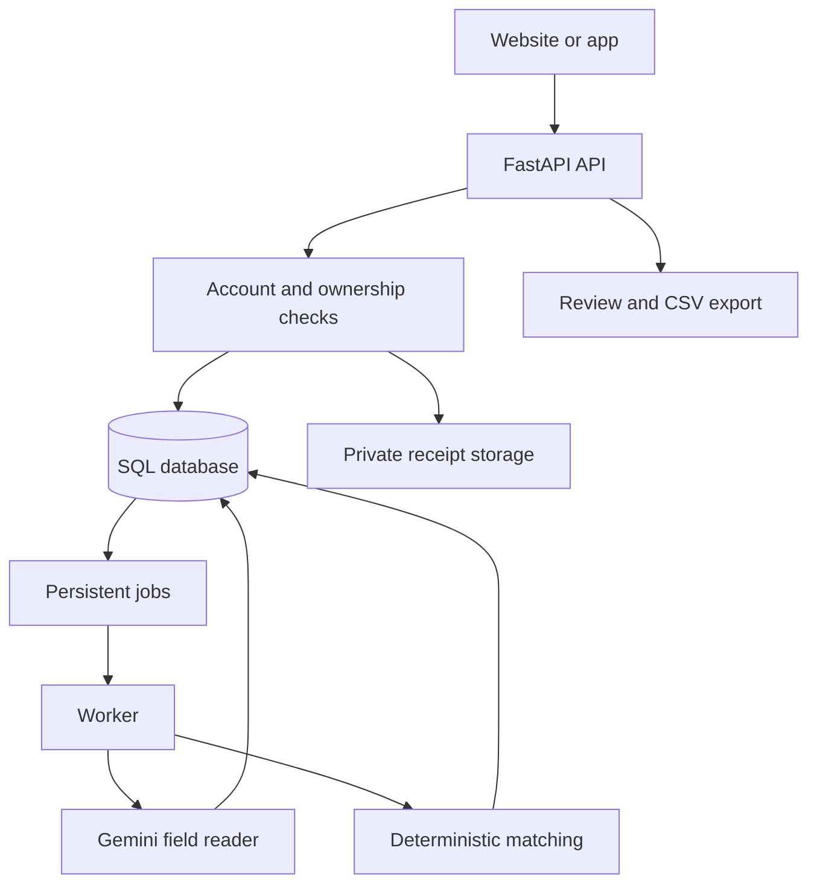

# Backend architecture

The browser sends a bearer session token. The API checks both authentication and ownership for every private object. The database is authoritative; the frontend never supplies a trusted verdict or credit allocation.

## Main entities

| Entity | Stored information |
|---|---|
| User + SessionToken | Account, password hash, hashed revocable sessions |
| Content | Owner, key, JSON value, edit version |
| Batch | Owner, revision, expiry, latest run, synthetic flag |
| Order | External order reference, customer, amount in paisa, receiving account |
| Statement + StatementLine | Declared coverage, source-profile flags, normalized credits/debits |
| Claim | Order link, private image filename/hash, extracted fields, both reads, edit version |
| Job | Kind, idempotency key, state, lease, progress, sanitized error |
| Run + Match | Input revision, rule version, evidence, candidates, machine and final outcomes |
| Allocation | One retained credit assigned to one order and claim |
| AuditEvent | Actor, action, reason/details, timestamp |

Foreign keys cascade on deletion. Unique constraints protect account emails, content keys, order references within a batch, one statement per account per batch, job keys, run revisions, and credit allocation. Alembic owns schema changes.

## Matching rules

Auto-Ship needs one linked checked proof, a positive PKR amount equal to the order, consistent account, full unmasked reference, no duplicate proof, complete declared statement coverage, verified reference correspondence, one matching unallocated credit, and no date/amount conflict. It is a reconciliation result against supplied records.

Amount/time candidates alone always go to Review. An incomplete date, blurry amount, disagreements between reads, repeated reference, reused image, masked reference, duplicate statement credit, missing coverage, or missing profile verification also requires Review. No candidate with otherwise complete evidence can produce Hold. A near-boundary claim gets Review to allow a wider posting window.

`references_verified` means the seller has established that the reference shown by that sending app corresponds to the receiver statement's reference field. It is never inferred merely because the two columns have similar names. `complete` is the uploader's coverage declaration, not independent bank validation.

Human reviewers may select an available candidate and provide a reason. They can override a machine verdict, but cannot allocate an already assigned credit or a wrong amount/account. Machine verdict and evidence remain alongside the final decision.

## Transactions and recovery

SQLite write transactions use `BEGIN IMMEDIATE`. PostgreSQL uses batch row locks. A completed reconciliation and all its allocations commit together. Edits use batch revisions or object versions; stale writes return 409. Existing results must be explicitly reset before source inputs change.

The queue is stored in SQL so no Redis service is required. Workers claim jobs with leases; PostgreSQL supports skip-locked selection. Image-provider calls happen outside database write transactions. Results are persisted only if the worker still holds its lease. A crash can cause the provider call to repeat; it cannot authorize duplicate credit allocation.

## Deliberate boundaries

Local receipt files are an initial storage adapter. Shared multi-host deployments need a common protected volume or a private object-storage adapter. Account ownership is seller-level isolation; collaborative roles and invitations need a separate membership model. This system has no bank or wallet credentials, no payment initiation, and no direct identity-verification integration.
