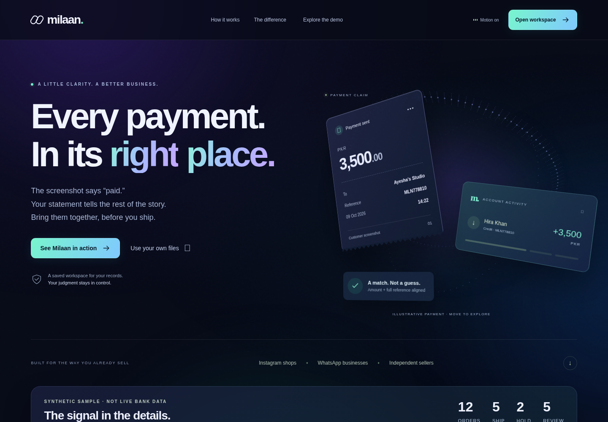

# Milaan — payment evidence reconciliation for online sellers

**Milaan** helps small sellers compare orders, screenshots and receiving-account statements and make explainable **SHIP / HOLD / REVIEW** decisions. It does **not** connect to banks, authenticate receipts, guarantee settlement or ship products. AI-assisted field extraction is optional, consent-gated and subject to human confirmation.

[Public website](https://milaan.app) · [Seller guide](https://milaan.app/guide) · [Privacy draft](https://milaan.app/privacy) · [Architecture](docs/ARCHITECTURE.md)



## What runs where

The public website is built from this repository's `main` branch by Render using the root `Dockerfile`; FastAPI serves both the site and the API. Deployments are **manual**, not automatic. PostgreSQL and private S3-compatible receipts are required for production; development defaults to SQLite and local files.

The earlier **ChatGPT Sites** workspace is a **separate historical project** and is **not** the source of the current public website. Changing this repository does not modify that separate Sites app. Historical reports may discuss it and must not be mistaken for current production behavior.

The public demo uses invented data and needs no account. A saved workspace requires sign-in; public signups remain closed until owner-approved launch gates pass. Do **not** upload real seller/financial records for unapproved testing.

## Five-line local quick start (Python 3.12)

```sh
python3.12 -m venv .venv
.venv/bin/python -m pip install -c milaan/backend/constraints-py312.txt -r milaan/backend/requirements.txt
.venv/bin/python setup_admin.py
cd milaan/backend && ../../.venv/bin/python -m alembic upgrade head
../../.venv/bin/python -m uvicorn app.main:app --host 127.0.0.1 --port 8000
```

Windows: use `SETUP.bat` and `START_DEMO.bat`; both were exercised in a disposable Windows GitHub Actions environment with a synthetic operator. Interactive operator entry still needs local testing. See [README_FIRST.md](README_FIRST.md).

## Guides, implementation and verification

- [Seller demo and Roman Urdu walkthrough](DEMO_GUIDE_ROMAN_URDU.md) · [Import/matching contract](docs/IMPORT_CONTRACTS.md)
- [Architecture](docs/ARCHITECTURE.md) · [Privacy and retention notes](docs/PRIVACY.md) · [Integrated release history](docs/V3_RELEASE.md)
- [Email integration](docs/V4_RESEND_EMAIL.md) · [Deployment safety](docs/RENDER_NEON_READINESS.md) · [Operations runbook](docs/OPERATIONS_RUNBOOK.md)
- [Public launch checklist](docs/PUBLIC_LAUNCH_GATES.md) · [Change proposals](docs/proposals/PRODUCT_DECISIONS.md) · [Prior review](docs/PUBLIC_LAUNCH_REVIEW.md)

Run the existing GitHub Actions release suite before approving any pull request. Backend, PostgreSQL/S3 synthetic, frontend, browser, migrations, Windows launch and public HTTPS checks have separate workflows and distinct limits. Historical reports reflect **their original dates**; they are not an assertion that today's live services were tested in those older sessions. Never use real financial records for tests.

**Source code has no public-product license yet.** Do not assume an open-source grant until the owner chooses one.
