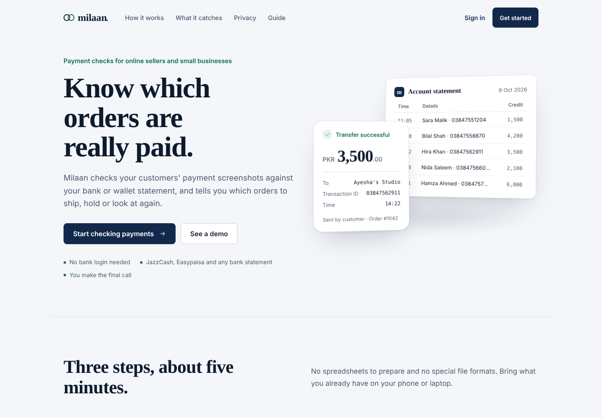

# Milaan

**Know which orders are really paid.** Milaan checks customers' payment screenshots against a seller's bank or wallet statement and marks every order **SHIP**, **HOLD** or **REVIEW**, with the reason behind it. It is built for Instagram and WhatsApp sellers and small businesses in Pakistan who are paid by bank transfer, JazzCash or Easypaisa.

Live at **[milaan.app](https://milaan.app)** · [Seller guide](https://milaan.app/guide) · [Architecture](docs/ARCHITECTURE.md)



## How a seller uses it

1. **New batch.** Name it (e.g. today's orders) and say which account customers pay into.
2. **Orders.** Paste them, one per line: `order number, customer name, amount` (commas, tabs or spaces). A CSV upload still works.
3. **Statement.** Upload the statement **PDF** from the bank or wallet app. Milaan reads the transactions, shows them in an editable table (rows that need a look are highlighted), and only imports after the seller confirms. CSV also works.
4. **Screenshots.** Attach each customer's payment screenshot to its order, enter or AI-read the amount, date and Transaction ID, and confirm.
5. **Check payments.** Every order gets SHIP / HOLD / REVIEW. Open any order to see why, record a decision and export the list.

Anyone can open the **sample shop** from the home page without an account.

Milaan never logs in to a bank and never moves money. It compares the records the seller uploads; the shipping decision is always the seller's.

## What's in the repository

| Path | What it is |
|---|---|
| `milaan/backend/app` | FastAPI app: accounts, batches, imports, statement PDF reader (`statement_pdf.py`), matcher, review decisions, email |
| `milaan/backend/migrations` | Alembic database migrations |
| `milaan/backend/tests` | Backend tests (PDF fixtures in `tests/fixtures`, all invented data) |
| `milaan/frontend/dist` | The website and workspace (plain ES modules, no build step). `seller-flow.js` holds the paste-orders and statement-check flow |
| `milaan/frontend/tests` | Node tests for the browser modules |
| `tests/browser` | Playwright tests on desktop and mobile |
| `Dockerfile` | Production image used by Render |
| `docs/` | Architecture, import rules, operations, deployment and privacy notes |

## Run it locally (Python 3.12)

```sh
python3.12 -m venv .venv
.venv/bin/python -m pip install -c milaan/backend/constraints-py312.txt -r milaan/backend/requirements.txt
cp milaan/backend/.env.example milaan/backend/.env      # development defaults: SQLite, local files, signup open
cd milaan/backend && ../../.venv/bin/python -m alembic upgrade head
../../.venv/bin/python -m uvicorn app.main:app --host 127.0.0.1 --port 8000
```

Open http://127.0.0.1:8000. On Windows, run `SETUP.bat` once, then `START_MILAAN.bat`.

For local sign-up without email, set `REQUIRE_EMAIL_VERIFICATION=false` in `milaan/backend/.env`.

## Tests

```sh
cd milaan/backend && python -m pytest tests matching/tests      # backend
node --test milaan/frontend/tests/*.test.mjs                    # frontend modules
cd tests/browser && npm ci && npm test                          # browser flows (desktop + mobile)
```

Never use real customer or bank records in tests. The statement PDF fixtures are regenerated with `python milaan/backend/tests/fixtures/make_statement_pdfs.py`.

## Production

milaan.app runs from this repository's `main` branch on Render (Docker) with PostgreSQL on Neon, private S3-compatible storage for screenshots and Resend for email. Deploys are manual. Settings that control public behaviour live in Render's environment, not in code:

| Setting | Effect |
|---|---|
| `ALLOW_REGISTRATION=true` | Lets new sellers create accounts (the site shows "Get started"). When `false`, only existing accounts can sign in. |
| `REQUIRE_EMAIL_VERIFICATION=true` | New accounts confirm their email with a 6-digit code (needs `RESEND_API_KEY` and `EMAIL_FROM`). |
| `EXTRACTION_PROVIDER=gemini`, `GEMINI_API_KEY`, `GEMINI_MODEL` | Optional AI reading of screenshots, only when the seller asks for it. |
| `BATCH_RETENTION_HOURS` | How long batches are kept (default 168 = 7 days). |

See [operations runbook](docs/OPERATIONS_RUNBOOK.md), [Render/Neon readiness](docs/RENDER_NEON_READINESS.md) and [launch checklist](docs/PUBLIC_LAUNCH_GATES.md).

**License:** none yet. All rights reserved by the owner until a license is chosen.
