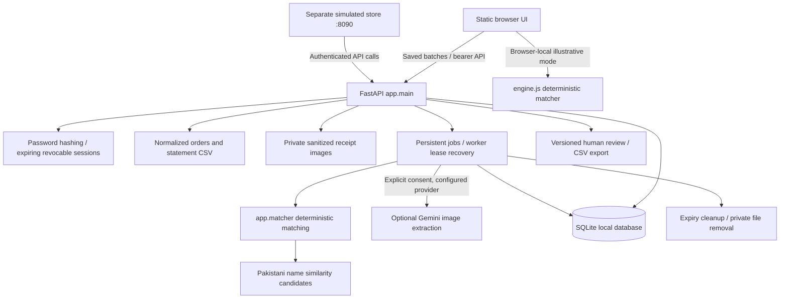

# Implemented local architecture

Canonical entry points: `milaan/backend/app/main.py:app`,
`demo-store/server.py:app`, `milaan/frontend/dist/app.js`.
The active saved matcher is `app/matcher.py`; `matching/names.py` supplies name
similarity. Other matching utilities do not replace the saved engine.
PostgreSQL configuration exists for shared deployments but was not runtime-tested
in this release pass. SQLite is the verified single-machine development path.

The separately hosted Sites workspace has no verified shared database, source,
synchronization or deployment pipeline with this checkout. Repository changes do
not deploy it. Its internal architecture and retention remain unverified.
